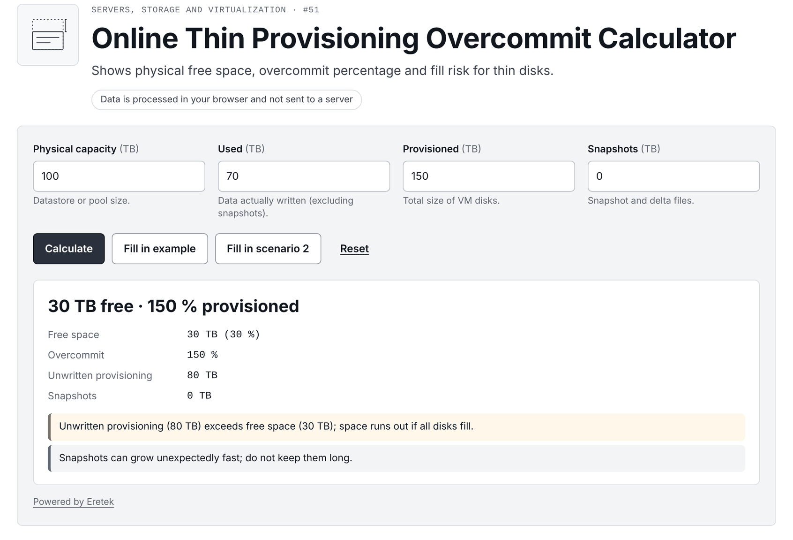

# Thin Provisioning Overcommit Calculator

From physical capacity, actual usage, provisioned space and snapshots, calculate free space, overcommit ratio and the gap if all disks fill up.

## Try it live

- [Türkçe](https://sistem.eretek.com/araclar/thin-provisioning-risk)
- [English](https://sistem.eretek.com/en/tools/thin-provisioning-overcommit)
- [Deutsch](https://sistem.eretek.com/de/werkzeuge/thin-provisioning-ueberbuchung)



## What it does

Shows physical free space, overcommit percentage and fill risk for thin disks.

With thin provisioning the sum of VM disks can exceed physical capacity; physical space runs out as disks are written. When it runs out, all VMs on the datastore stop at once. The tool compares unwritten provisioning with free space.

## Where it helps

When at risk, set datastore alarms at 80/90 %, estimate the full date with the growth forecast tool and delete old snapshots.

## How to use it

1. Enter physical capacity, actually used space, total provisioned to VMs and snapshot space in TB.
2. Press Calculate.

### Fields

| Field | Description |
|---|---|
| Physical capacity | Datastore or pool size. |
| Used | Data actually written (excluding snapshots). |
| Provisioned | Total size of VM disks. |
| Snapshots | Snapshot and delta files. |

## Example input

Press **Fill in example** in the tool to load this input.

| Input | Value |
|---|---|
| Physical capacity | `100` |
| Used | `70` |
| Provisioned | `150` |

**Expected result:** 100 TB physical, 70 TB used, 150 TB provisioned: 30 TB free, 150 % overcommit; 80 TB unwritten exceeds free space.

## Method and assumptions

Free = physical − used − snapshots. Overcommit = provisioned / physical. Unwritten = provisioned − used. Unwritten > free gives a risk warning; free below 10 % red, below 20 % amber.

## Limits and common mistakes

- Space reclaimed by compression, deduplication and UNMAP/TRIM is not estimated.

## Run it locally

The tool is plain HTML, CSS and JavaScript with no build step and no dependencies.

```bash
git clone https://github.com/eretek/thin-provisioning-overcommit.git
cd thin-provisioning-overcommit
node scripts/serve.js        # or: python3 -m http.server 8080
```

Open <http://127.0.0.1:8080/>. Add `?lang=tr` or `?lang=de` for Turkish or German; without it the page follows the browser language and falls back to English. You can also open `index.html` directly from disk.

Run the tests (Node.js 18 or later):

```bash
node test/run.js    # or: npm test
```

The tests run the tool's own fixtures and the worked examples in all three languages without a browser.

## How it works

All processing happens in your browser. The tool makes no network requests, uses no cookies or browser storage, and does not upload files you select.

No server-side component is needed. The version on the Eretek website renders the same page through a private WordPress plugin; that plugin only produces the page markup and is not part of this repository.

| Path | Purpose |
|---|---|
| `index.html` | Page shell |
| `src/app.js` | Builds the page in Turkish, English or German from `src/data.js` |
| `src/data.js` | Field definitions, examples and all texts in three languages |
| `src/core.js` | Shared runtime: validation, number formats, result rendering, CSV/ICS export |
| `src/tool.js` | The calculation or analysis for this tool |
| `docs/screenshot.png` | Screenshot used in this README |
| `src/tools.css`, `src/page.css` | Styles |
| `test/run.js`, `test/cases.json` | Headless tests |

## License and attribution

This tool is released under the [Eretek Website Attribution License](LICENSE). You may use, modify and redistribute it, including commercially. If you make it available on a website or web application, show a visible, clickable credit linking to https://eretek.com/ on every page where the tool is available, for example:

```html
<a href="https://eretek.com/">Powered by Eretek</a>
```

You may add `rel="nofollow"` to the link. Keep the copyright notice and license text in copies and redistributions.
